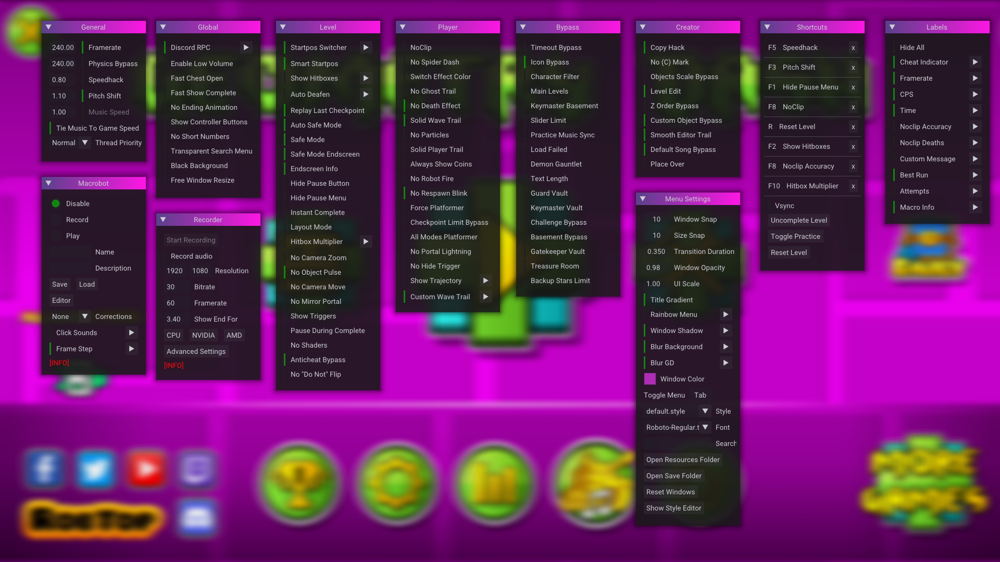

# GD Mega Overlay

## Description

Open-source, feature-rich, GUI-integrated Geometry Dash mod menu. This Android ARM64 port targets Geometry Dash 2.2081 with Geode 5.11.2 or newer. This fork’s CI builds Android64 only; the upstream project has separate desktop builds.

## Android installation

1. Install the official Geode Android launcher compatible with Geometry Dash 2.2081.
2. Download `maxnu.gd_mega_overlay.geode` from the published GitHub release.
3. Copy it to the Geode mods folder (for the standard Android launcher):
   `/storage/emulated/0/Android/media/com.geode.launcher/game/geode/mods/`
4. Restart Geometry Dash.
5. Tap the floating blue Easy-face button to open the overlay.

## Android port status

The Android ARM64 port is maintained as a separate compatibility target for Geometry Dash 2.2081. It adds a movable floating menu button, an in-menu close control, and touch input forwarding to the ImGui interface. The software pointer and multi-touch gestures are still considered experimental until verified on a physical Android device.

Android builds are produced by GitHub Actions for the `Android64` target. Pushing a `v*` tag creates a **draft prerelease** after the Android build passes; review the draft and test the `.geode` package on-device before publishing it.

Known Android limitations are documented in [`ANDROID_PORT_NOTES.md`](ANDROID_PORT_NOTES.md). Do not assume every Windows-oriented hack is available or safe on Android.

## Features

* Basic hacks
* Startpos Switcher
* Macro Bot
* Internal Recorder
* Layout Mode
* and much more!

## Credits

[SpaghettDev](https://github.com/SpaghettDev) helped a ton with various features

[Prevter](https://github.com/Prevter) added multiple patches

[mat](https://github.com/matcool) for internal recorder

[^1]: You can download source code using ``git clone https://github.com/maxnut/GDMegaOverlay.git``, or on [github.com/maxnut/GDMegaOverlay](https://github.com/maxnut/GDMegaOverlay) (the page you are likely on) you can press "Code" and then press "Download Zip", unzip the zip file and modify to your liking. Recommended you create a fork and save your changes there.
